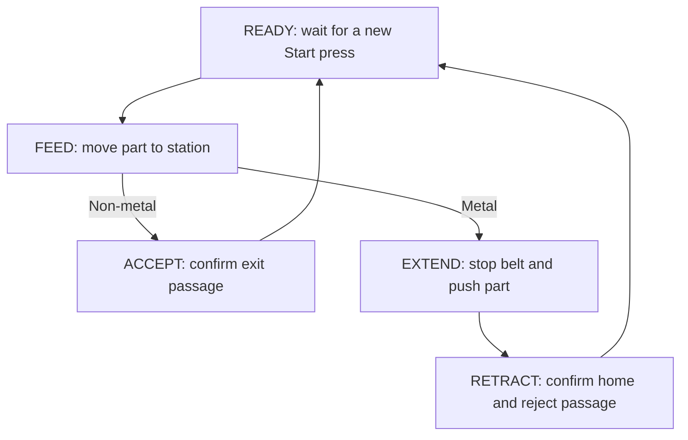

# Conveyor Sorting Cell — Automation Portfolio Project

A student-scale automation project: transport one part, classify it with a simulated inductive sensor, send non-metal parts to the accept exit and divert metal parts to a reject chute. Demonstrate sequencing, feedback, fault handling and verification before connecting any hardware.

**Status: tested Python reference starter; PLC, HMI and CAD implementation planned.** The included demos use scripted sensor inputs. They are not a physics simulation, a connected PLC, or evidence of a commissioned machine.

## Start here

```bash
git clone https://github.com/veyrazone-ui/test-1.git
cd test-1
python -m unittest discover -s tests -v
python -m simulation.run_demo --scenario accept
python -m simulation.run_demo --scenario reject --trace artifacts/reject.csv
python -m simulation.run_demo --scenario feed-jam
python -m simulation.run_demo --scenario interlock
```

Use Python 3.12 for the documented baseline; no third-party Python packages are required. On Windows, use `py -3.12` in place of `python` if needed. On Linux/macOS, the command may be `python3`. Run the commands from the repository root.

Expected final results:

| Demo | State | Accepted | Rejected | Fault |
| --- | --- | ---: | ---: | --- |
| `accept` | READY | 1 | 0 | NONE |
| `reject` | READY | 0 | 1 | NONE |
| `feed-jam` | FAULT | 0 | 0 | FEED_TIMEOUT |
| `interlock` | FAULT | 0 | 0 | INTERLOCK_OPEN |

Fault demos intentionally finish in FAULT and exit normally. Use the test suite for pass/fail checks. See the [recorded baseline results](evidence/validation.md).

## Engineering problem and scope

A small sorting station needs to route parts reliably and explain why it stopped. The first version prioritizes predictable control over throughput. One part is manually staged upstream of the station, and a new Start press is required for each cycle.

Included in the intended MVP:

- A cyclic controller with explicit states and symbolic I/O.
- One conveyor command and one spring-return pusher extend command, with home/extended feedback.
- Metal/non-metal classification sampled once when the part reaches the station.
- Separate accept/reject passage sensors and counts confirmed by completed passage.
- Movement timeouts, unexpected-sensor checks, latched faults, Stop and deliberate Reset/Start recovery.
- A PLC implementation in Structured Text, an operator display, a small CAD layout and repeatable test evidence.

Not included in the MVP: continuous feeding, multiple parts in flight, machine vision, servo motion, real pneumatic hardware, a safety PLC, cloud connectivity, or production certification. An optional CAD-to-CAM study uses one sensor mounting plate from this same cell.

## Normal sequence



Startup is STOPPED. Reset can establish READY only with a clear cell and the pusher home. Stop removes movement commands and returns to STOPPED; a fault removes commands and latches FAULT. Neither clearing a fault condition nor holding Start causes a restart. Full behavior is specified in [requirements](docs/requirements.md) and [control design](docs/control-design.md).

## What is available now

| Component | Status |
| --- | --- |
| Scope, assumptions, state behavior and I/O map | Written |
| Python reference controller | Implemented |
| Four deterministic demos and CSV trace export | Implemented |
| Automated reference tests | 27 tests passed locally; includes parameterized state cases |
| Continuous-integration workflow | Included; check the repository Actions tab for hosted run status |
| CODESYS PLC project and PLC test results | Planned; not compiled or tested yet |
| HMI and CAD models | Planned; briefs included |
| CAM toolpaths / physical prototype | Optional future work; not produced or tested |

## Tools

| Tool | Purpose | Why it fits |
| --- | --- | --- |
| Python 3.12 + `unittest` | Reference controller, repeatable scenarios and regression tests | Standard-library-only starting point |
| CODESYS Development System V3, Structured Text | PLC port and cyclic task behavior | IDE simulation supports testing without a physical controller |
| CODESYS watch list; optional IDE visualization | Input forcing, state/fault display and operator controls | Keep the initial HMI small and local |
| FreeCAD | Conveyor layout and parametric sensor mounting plate | Open-source CAD with a CAM workbench for the optional extension |
| Git + GitHub | Reviewable changes, documentation and test history | Every engineering change can be tied to evidence |

CODESYS Development System is available as a free download; runtime products and add-ons have separate licensing. Use **IDE simulation** for this project, not an assumed permanently free SoftPLC runtime. Record your installed versions in the evidence. See [setup and official sources](docs/tools-and-sources.md).

## Repository layout

| Path | Contents |
| --- | --- |
| `README.md` | Project overview, quick start and status |
| `docs/requirements.md` | Scope, measurable acceptance criteria and limits |
| `docs/control-design.md` | State transitions, timing, recovery and fault policy |
| `docs/io-map.csv` | Symbolic input/output definitions |
| `docs/implementation-plan.md` | Eight stages, learning outcomes and completion gates |
| `docs/test-plan.md` | Requirement-to-test mapping and PLC replay procedure |
| `docs/tools-and-sources.md` | Setup guidance and official references |
| `simulation/` | `controller.py`, `scenarios.py`, `run_demo.py` |
| `tests/` | `test_controller.py` and test discovery support |
| `plc/README.md` | PLC project structure and porting steps |
| `hmi/README.md` | Operator screen and simulation-panel brief |
| `cad/README.md` | Layout, mounting-plate brief and design checks |
| `cam/README.md` | Optional manufacturing study and verification gate |
| `evidence/` | Baseline results, example traces and a future-results template |
| `.github/workflows/checks.yml` | Automated Python tests on push and pull request |

## Implementation route

Suggested pace: **eight weeks at roughly 4–6 hours per week**, adjustable around coursework. This leaves time to refine the project before an April 2027 internship if started in late 2026. These are proposed stages, not claimed completed work.

| Stage | Main deliverable | Completion gate |
| --- | --- | --- |
| 1 | Understand the reference model and requirements | Explain both routes; change a timer and predict the test result |
| 2 | PLC feed/accept sequence | Compile; show clear startup, Start edge and confirmed accept count |
| 3 | PLC reject path and fault recovery | Demonstrate missing feedback, timeout and deliberate restart |
| 4 | PLC verification | Replay the test matrix; retain actual results and traces |
| 5 | Operator display | Show state, sensor status, counters and useful fault/recovery text |
| 6 | CAD layout and sensor mounting plate | Save editable model, STEP export and dimensioned drawing |
| 7 | Optional CAM study, or extra PLC robustness work | Verify toolpath simulation, or add and document a new fault test |
| 8 | Portfolio demonstration | 60–90 second demo, evidence table and engineering reflection |

Detailed tasks, estimated hours and learning outcomes are in the [implementation plan](docs/implementation-plan.md).

## What an internship reviewer can assess

The finished project should show the ability to translate a process into I/O and state logic, justify timer settings, use sensor feedback rather than delays alone, test failure paths, design a manufacturable mounting part, and explain limitations. The current scaffold demonstrates the reference-model and documentation foundation; it does not establish the author's PLC or CAD proficiency by itself.

For the final portfolio, include the PLC source/export, software versions, actual test outcomes, a CAD drawing and a short walkthrough of one normal cycle and one fault/recovery cycle. Keep a brief record of decisions, fixes and any assistance used. Do not claim physical validation or measured throughput without that evidence.

## Simulation boundary

This repository does not implement a machine safety function. `permissive_ok` is a simulated status input. Turning software commands off does not prove that a real conveyor stops or a pneumatic cylinder stays still. Physical adaptation requires a separately designed and reviewed safety system, guarded equipment and supervised commissioning.
